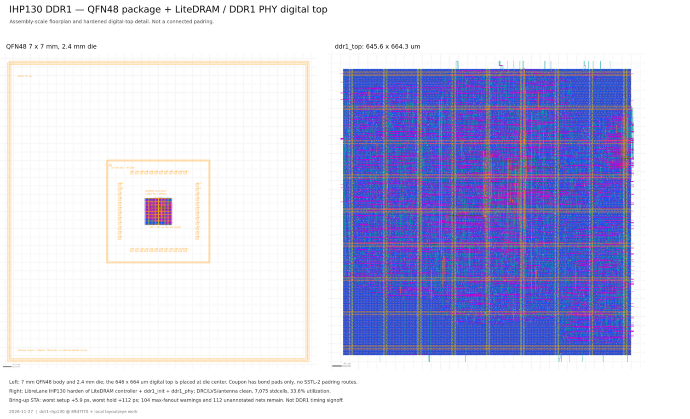
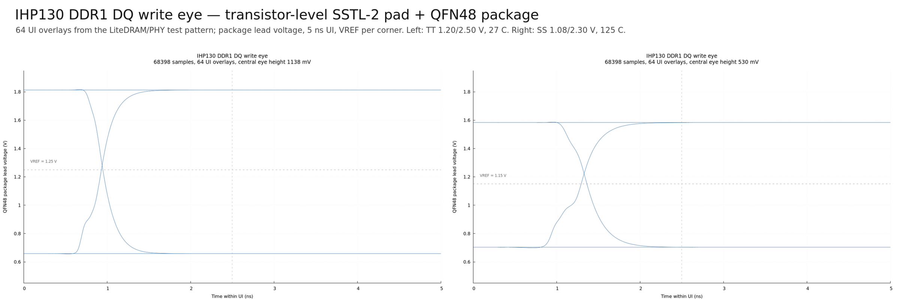

# ddr-phy

面向 [LiteDRAM](https://github.com/enjoy-digital/litedram) 控制器的外部 DRAM ASIC PHY，覆盖四套开源 PDK：**sky130、gf180mcu、IHP SG13G2（130 nm）、ICsprout 55**。控制器沿用 LiteDRAM，不改它的调度、刷新和交叉；本仓库做可综合的数字 PHY 和手工 I/O pad。四套工艺共用同一套数字 PHY 和同一张 pad 原理图，换的是器件和电源，不是四套架构。

设计决策、证据边界和分期计划的权威记录在 [docs/ARCHITECTURE.md](docs/ARCHITECTURE.md)。

## 设计分类

| 类 | 存储器 | 接口 | 工艺 | VDDIO | 状态 |
|---|---|---|---|---|---|
| S | SDR SDRAM | 与 `GENSDRPHY` 相同的 DFI，1:1 | 四套全做 | 3.3 V | 数字核已实现并通过多层验证 |
| D | DDR1 | 半速 DFI，单 rank x8 / BL4 / CL2 | sky130、IHP、ics55（候选） | 2.5 V | IHP130 全顶已硬化并导出装配版图/写眼；数字闭环 CK 10/11/12 ns × tDQSCK 三角全过；无已签核 padring |
| D2 | DDR2 | LiteDRAM DDR2 DFI，1:2，带 ODT | 仅 55 nm（需自研 SSTL_18 IO） | 1.8 V | 远期 |

第一版硅目标是点对点一颗 x8，SDR 的 CK = 100 MHz。不做 DIMM、fly-by、写电平；SPD 和 ECC 不在 PHY 里。

## 当前进展

Class S 数字侧已经有的东西：

- `rtl/sdr_phy.sv` — 1:1 SDR PHY，采用 `GENSDRPHY` 单相 DFI 几何；写延迟 0，裸核读延迟 CL+1，DQ/DQM/OE 同一下降沿发射，三态驱动留给 pad。
- `rtl/sdram_phy_top.sv` — 集成 CK 转发、写命令和 OE 的同拍资格判断，以及 `cap_clk` 读捕获 FIFO。默认集成读延迟 CL+4（CL2 为 6 拍、CL3 为 7 拍）；控制器须遵守 [集成接口契约](specs/interface.yaml)，不能照搬 `GENSDRPHY` 的读延迟。
- `rtl/sdr_ctrl.sv` — 闭环用的 1:1 控制器（不是 LiteDRAM 网表），抄 `GENSDRPHY` 的 DFI 时序和初始化命令顺序；WRITE 受 PHY `turnaround_busy` 门控；可选 tREFI 刷新。
- `rtl/sdr_bist.sv` — PRBS-8 写读比对 BIST，可选 `phase_sel` 扫描。诊断辅助，不是时序签核，也不实现 DRAM 训练。
- `rtl/read_capture_cdc.sv`、`rtl/dq_turnaround.sv`、`rtl/clock_forward.sv`、`rtl/phy_io_adapter.sv` — 读捕获 CDC、读写转向守护、时钟转发、pad 适配。

验证与实现证据（分层，不越级）：

1. **DFI 行为**：`tb/tb_sdr_phy.sv`，CL 2/3 × x8/x16 通过。
2. **引脚级闭环**：`sim/sdram_model.sv` + `tb/tb_sdr_loop.sv`，行命中、换 bank、换行、掩码写、BL 2/4/8 突发通过。模型只报命令顺序错误，不测 tRCD/tRP/tRAS/tRFC。
3. **命令间隔**：`sim/sdram_checker.sv`，按 Micron 256Mb SDR -75 档（tCK = 10 ns）数时钟，每条规则一个实例。
4. **时序感知数字测试**：`sim/sweep.sh` 做相位扫描；`sim/phy.sh` 覆盖 CL2/3、固定及 ±2 ns 捕获相位下的单次及 24 次连续读、缺失捕获的报错，以及两次连续写在引脚 CK 边沿的 DQ/DQM setup/hold。使用行为 pad，不是片外时序签核。
5. **门级功能**：`sim/gate.sh` 把 `sdr_phy` 映到 sky130 HD 跑功能仿真。无 SDF、无线延迟、无 pad——不是时序仿真，更不是签核。
6. **物理实现**：`flow/` LibreLane，sky130 控制组 80/80 跑通；草稿 SDC 故意未接入（见 `docs/STA_PLAN.md` §5）。
7. **pad**：`generator/` 产出四套工艺的拓扑模板（`sch/pads/`），gf180mcuD / sky130 / IHP 已绑定器件并生成；已有预驱动+输出级/接收器切片和 ESD 反向泄漏的 ngspice 仿真，标为 `design_assumption`。ics55 缺 3.3 V ESD 二极管 SPICE 卡（`docs/ICS55_ESD_3V3.md`）。尺寸未签核。
8. **可选差分**：`sim/micron_diff.sh` 对 Micron MT48LC16M16A2 行为模型做差分测试；模型本地获取、不随仓库分发，缺席时自动跳过。

### DDR1 SSTL-2 pad 生成器（跨四工艺，2026-11-26）

DDR1 的 SSTL-2 I/O pad 走**共享引擎 + 每工艺薄 profile** 的生成器链：`generator/char_ddr1_sstl2.py`（工艺中立表征）+ 每工艺 `char_ddr1_<pdk>.py` / `ddr1_<pdk>_backend.py` / `specs/ddr1/<pdk>-sstl2.yaml` / `sch/pads/<pdk>/sstl2_dq.spice`。契约在 `generator/LANE_CONTRACT.md`，细节在 `docs/PAD_GENERATOR.md` "跨四工艺 DDR1 SSTL-2 生成器链"。四 lane 现状（实测，均 signoff=false）：

- **ihp130**：完整 PASS（7 PVT × 3 VTT），参考 lane，逐值复现原表征。
- **gf180mcu**：仿真完整跑通但**电气无可行解**（`results/gf180mcu/ddr1-tune-20261126.json`）——3.3 V 器件欠压 2.5 V 驱动不足，TX 卡 ~1.2 V 中间电平且与尺寸无关，定量坐实"无 2.5 V IO 器件即不可行"。witness 级证据。
- **sky130**：模型层全通（大器件须用 `mult` 而非大 `nf` 绕开 ngspice BSIM4 bin 的负 u0 fatal；`g5v0d10v5` 须 l≥1.0 µm）；但 bin 模型求值成本使单瞬态 bench 超 400 s 仍无有效迭代——**效率型不可行**而非模型缺失，完整网格需换 xyce/商业仿真器。
- **ics55**：唯一原生 2.5 V IO 器件 + 2.5 V 二极管。**全 7 PVT 角 PASS + dev_multi_corner tune PASS**（证据 `results/ics55/ddr1-tune-20261126.json` dev 跨 tt/ss_low/ff_high 三角，7 角 witness `results/ics55/ddr1-corner-witness-20261126.json`）：推荐 xrdriver_w 12 / xrbias_l 10，tt rx_rise 0.86 ns / tx_high 1.885 V / tx_low 0.617 V，最严苛 ss_low(1.08 V core/2.3 V IO/125 °C)rx 1.34/1.36 ns、tx 1.16/1.42 ns 全达标，ff_high 最快 0.54/0.56 ns。corner 接入靠逐角提取非零 wrapper 偏移生成 `cornerparams_{tt,ss,ff,fnsp,snfp}.inc`（生成器 `generator/gen_ics55_corners.py` reproducible）。原 tt-only 设计在 ss 角 tx_fall 卡 1.8 ns 不可调（driver/电阻 knobs 全无效，瓶颈在 cross-coupled latch 搬移器翻转 + 低压核心逻辑链），经电平搬移器/RX 重设计（搬移器 NMOS 下拉 5→12 µm + core_inv 加强 + XRDOWN 电阻 10→5 µm + RX 输出缓冲加强）后全角达标。修复链含电阻换高阻 `re_hrpo`、ESD 二极管补 `area=20µm²`(hiz −18µA→−0.167µA)。20µm² 为 witness 假设非 HBM 签核，一律 evaluation-only、signoff=false。

跨 PDK 关键方法：BSIM4-binned PDK（sky130/gf180）的大器件用平行 multiplier 而非大 nf；IHP 用 PSP103 不受影响。

### DDR1 数字闭环（P2）

DDR1 走**生成器**路径，不再有手写的固定时序控制器：

- `specs/ddr1/mt46v32m8-75e.yaml` — Micron 256Mb DDR Rev. O（01/2009）Table 21 的便携器件档案：几何、电源等待 200 us、DLL 锁定 200 CK、全部 ps/CK 时序。
- `generator/emit_ddr1.py` — 档案 + CK 周期 → 自包含束：`ddr1_controller.v`（真实 LiteDRAM `LiteDRAMController` + crossbar，时序从档案注入 `TimingSettings`）、`ddr1_timing.vh` 引脚宏、`ddr1_init_params.vh` / `ddr1_init_steps.vh` 初始化参数与 case 表、`ddr1_contract.json` 摘要，以及原样拷贝的 `rtl/ddr1_top.sv` / `ddr1_init.sv` / `ddr1_phy.sv`。ps 域命令间隔到半速 sys 周期用 `ceil((ps + ck_ps)/sys_ps)`——相位 0 命令与相位 1 CAS 之间隔一个相位错开，必须多给一拍；tREFI 用 floor（提前刷新永远合法）。
- `rtl/ddr1_top.sv` — Native 口顶层，接线 init/controller/PHY。Native 口是**固定调度**：读无 backpressure（`r_valid` 在控制器固定延迟到达），写无 `w_valid`（`w_ready` 即接受沿，数据必须在场）；`init_done` 之前三个 ready/valid 全为 0。
- `rtl/ddr1_init.sv` — 可综合初始化序列器，命令表完全由生成的 `.vh` 提供。
- `rtl/ddr1_phy.sv` — 单 byte lane 数字 PHY，两相 DFI，读返回延迟 5 sys、写延迟 1 CK；CK/CK90 理想相位与 DQS 居中延迟是后端义务。

回归矩阵 `sim/ddr1.sh`：CK ∈ {10, 11, 12 ns} × tDQSCK ∈ {-750, 0, +750 ps}（-75E 档窗口）共 9 角。每角重跑生成器（时序常数随 CK 变化）+ Yosys `scc` 组合环检查 + Icarus 闭环：

- `sim/ddr1_device_model.sv` — ps 精度引脚模型，按 `CL·CK + offset` 发 DQS、DQ 每拍附加 tDQSQ 偏移，写侧检查每个 DQS 边沿对齐 CK ±1 ps 且恰好收满 BL 拍；几何（bank/row/掩码）、初始化次序（DLL 复位前不得刷新、200 us 前不得有数据）、掉电保持全由它裁决。
- `sim/ddr1_timing_checker.sv` — 被动命令间隔检查：tRCD/tRAS/tRP/tRC/tRRD/tRFC/tMRD（ps）与 tCCD/tWTR/tRTP（CK），写恢复锚点 `cmd + (CWL+BL/2)·TCK + tWR`。
- `tb/tb_ddr1_loop.sv` — 覆盖顺序/跨 bank/跨行/掩码写读、背靠背写与读、换 bank 换行、初始化负向探针（上电窗口内发命令必须不落到引脚）。

```sh
git submodule update --init third_party/litedram
python3 -m venv /tmp/ddr1-venv
/tmp/ddr1-venv/bin/python -m pip install migen==0.9.2 litex==2024.12
PYTHON=/tmp/ddr1-venv/bin/python sh sim/ddr1.sh
```

需 Yosys、Icarus Verilog。模型通过不等于 SSTL-2 pad、ADPLL 或布线后签核；读捕获在 ±750 ps 角下成立只证明数字窗对齐，不证明后端延迟线精度。

CI（`.github/workflows/ci.yml`）跑生成器检查、产物一致性、SDR 回归、DDR1 Native 闭环、退出码变异测试和可选 SDR Micron 差分。

### DDR1 IHP130 单 DQ pad

[`sstl2_dq.spice`](sch/pads/ihp130/sstl2_dq.spice) 是 SG13G2 的 2.5 V SSTL-2 双向 DQ 晶体管级原型：1.2 V 核心接口、VREF 差分接收、推挽 TX 和独立的上电三态许可。它还未接入数字闭环。

```sh
python3 generator/char_ihp130_sstl2.py --output /tmp/ihp130-sstl2.json
```

需 PyYAML、支持 OSDI 的 ngspice 和 SG13G2 模型。脚本自动发现 Ciel 安装，或用 `--pdk-root` 固定版本。[负载、PVT、上电前提与物理实现缺口](docs/PAD_GENERATOR.md#ihp-sg13g2-ddr1-单-dq)。

`sh sim/ihp130_dq_layout.sh` 生成单 DQ GDS，运行 SG13G2 宏级 DRC/LVS 并生成 Magic RC 网表。版图有 9 个端口，`VSSIO` 为共用衬底回流，原理图的 `VSS` 不另引出。[版图证据、PEX 复现及签核边界](docs/PAD_GENERATOR.md#ihp-sg13g2-单-dq-版图与-pex)。

### DDR1 IHP130 全链路版图与眼图（2026-11-27）

`flow/config.ddr1_top.json` 把生成的 **LiteDRAM controller + `ddr1_init` + `ddr1_phy`** 作为 `ddr1_top` 硬化；`flow/prep_ddr1_top.sh` 先为 CK=10 ns 生成自包含束。LibreLane IHP130 80/80 完成，DRC/LVS/天线均为 0：

| 项目 | 结果 |
|---|---|
| die | 645.61 × 664.33 µm |
| 标准单元 | 7,075 个 / 134,599 µm² |
| 全部实例（含 fill） | 32,136 |
| 典型功耗 | 7.41 mW |
| setup/hold | +5.9 ps / +112 ps；SDC 仍是 bring-up |
| max-fanout 告警 | 104 |
| unannotated net | 112 |

导出物：

- `results/ihp130/ddr1_top/gds/ddr1_top.gds` — 数字全顶层版图。
- `results/ihp130/ddr1_qfn48_assembly.gds` — QFN48 7×7 mm / 2.4 mm die coupon + 数字 top 落点。
- `results/ihp130/ddr1_qfn48_layout_sheet.png` — 装配版图标注页。
- `results/ihp130/ddr1_eye_tt_ss.png` — TT/SS DQ write eye 对比。
- `results/ihp130/ddr1_eye_tt.png`、`ddr1_eye_ss.png` — 单角眼图。



眼图链路：`tb_ddr1_ihp130_loop` 的 16-word LiteDRAM/PHY 测试图案 → 晶体管级 `sstl2_dq.spice` → QFN48 最差 pin 的 `L=3.037 nH / R=0.142 Ω / C=0.1 pF` → 50 Ω 到 VTT。64 UI、5 ns UI；TT 中心眼高 **1,138 mV**，SS 1.08 V/2.30 V/125 °C 中心眼高 **530 mV**。



```sh
PYTHON=/tmp/litedram-venv/bin/python sh flow/prep_ddr1_top.sh
PATH=/nix/var/nix/profiles/default/bin:$PATH TOP=ddr1_top sh flow/run.sh ihp130

python3 generator/compose_ddr1_layout.py
python3 generator/render_gds.py --gds results/ihp130/ddr1_qfn48_assembly.gds \
  --png results/ihp130/ddr1_qfn48_assembly.png --width 2200 --height 2200 --tech sg13g2

/tmp/pkgvenv/bin/python generator/eye_ddr1_ihp130.py --case tt \
  --output results/ihp130/ddr1_eye_tt.csv --deck results/ihp130/ddr1_eye_tt.spice
/tmp/pkgvenv/bin/python generator/eye_ddr1_ihp130.py --case ss_low \
  --output results/ihp130/ddr1_eye_ss.csv --deck results/ihp130/ddr1_eye_ss.spice
```

边界：QFN48 装配图只有 coupon bond pad，**没有 SSTL-2 padring 信号布线、bondwire 或封装 3D EM**；眼图是 **write eye**，不是读眼，也没有 DQS 抖动、SSO、串扰或 PCB。两者都不构成 DDR1 签核，详见 [`reports/ddr1/ihp130-layout-eye.md`](reports/ddr1/ihp130-layout-eye.md)。

## 目录结构

```text
rtl/            可综合 SystemVerilog：PHY、控制器、BIST、读捕获、转向、时钟转发、pad 适配
tb/             测试台（Icarus Verilog，-g2012）
sim/            行为/时序模型、检查器、回归脚本、门级网表壳
generator/      Python 生成器与证据检查：pad 拓扑、器件抽取、PDK 规则、时序、封装
specs/          接口契约（interface.yaml）、时序契约（timing_contract.yaml）、器件与 pad 规格
sch/pads/       生成的 pad 拓扑与封装产物，以及工艺专用晶体管级宏
backends/       各 PDK 后端配置（sky130 / gf180mcu / ihp130 / ics55 / generic_sim）
flow/           LibreLane 硬化流程（run.sh、config、SDC 草稿）
docs/           架构与专题文档（中文）
third_party/    litedram（submodule，不改）；reference/（本地评估模型，不分发）
results/        物理实现产物（gitignore）
```

## 快速开始

依赖：Icarus Verilog、Yosys、Python 3 + PyYAML。物理流程另需 LibreLane 环境（脚本会自动进 `/opt/librelane` 的 nix-shell）和对应 PDK。

```sh
# 基础回归：DFI 行为、引脚级模型、控制器闭环、命令间隔检查
sh sim/run.sh

# 增强 PHY 模块、DQM 读掩码、BIST 闭环（x8 / x16）
sh sim/phy.sh

# pad 能力报告 + pad 适配契约测试
sh sim/pad.sh

# 时序感知读捕获相位扫描 + 负向测试
sh sim/sweep.sh

# 退出码变异测试：注入错误必须让仿真器非零退出
sh sim/mutation.sh

# 可选：Micron 参考模型差分（模型缺席时跳过，获取方式见 docs/DRAM_MODEL_REFERENCES.md）
sh sim/micron_diff.sh

# sky130 HD 功能门级（无 SDF）
sh sim/gate.sh

# 生成器与证据检查
python3 generator/check_pads.py
python3 generator/check_capabilities.py
python3 generator/check_timing.py

# LibreLane 硬化：sky130（默认）/ ihp130 / ics55 / gf180-as-7t3v3
sh flow/run.sh sky130
```

gf180 必须用 3.3 V AS 标准单元视图（先在 `./pdks/gf180mcuD` 组好）；foundry 的 5 V 单元库不是本 PHY 的规格。

## 文档

- [ARCHITECTURE.md](docs/ARCHITECTURE.md) — 架构决策、DFI 契约、手工 I/O 分工、验证分层、分期与缺口
- [PHY_RTL_GAPS.md](docs/PHY_RTL_GAPS.md) — RTL 已知缺口
- [STA_PLAN.md](docs/STA_PLAN.md) / [TIMING_BUDGET.md](docs/TIMING_BUDGET.md) / [TIMING_SWEEP.md](docs/TIMING_SWEEP.md) — 时序约束与预算
- [PAD_GENERATOR.md](docs/PAD_GENERATOR.md) / [PAD_ADAPTER.md](docs/PAD_ADAPTER.md) — pad 生成器与适配契约
- [ESD_STRESS_PLAN.md](docs/ESD_STRESS_PLAN.md) / [ICS55_ESD_3V3.md](docs/ICS55_ESD_3V3.md) — ESD 计划与 ics55 3.3 V 缺口
- [DRAM_MODEL_REFERENCES.md](docs/DRAM_MODEL_REFERENCES.md) — DRAM 参考模型的来源与许可边界
- [SI_PI_PACKAGE_PCB.md](docs/SI_PI_PACKAGE_PCB.md) / [PACKAGING_PROFILES.md](docs/PACKAGING_PROFILES.md) — 封装与板级
- [ihp130-layout-eye.md](reports/ddr1/ihp130-layout-eye.md) — IHP130 全顶、QFN48 装配版图与 DQ 写眼导出

## 许可

本仓库源码采用 **Apache-2.0**（见 [LICENSE](LICENSE)，源文件带 SPDX 头）。第三方材料各有边界：

- `third_party/litedram` 是 submodule，BSD 许可（EnjoyDigital），本仓库不修改它。
- Micron MT48LC16M16A2 行为模型为 "All rights reserved"，**不随仓库分发**，仅本地评估使用（已 gitignore）。
- ICsprout 55 foundry SPICE 模型是厂商数据，不在 Apache-2.0 之内，只供教学和研究评估；用它做的仿真不构成签核，也不能当可再发布的 PDK 附件。
- JEDEC 标准正文不在本仓库；时序默认值来自公开的颗粒数据手册二次资料，出处见架构文档。
