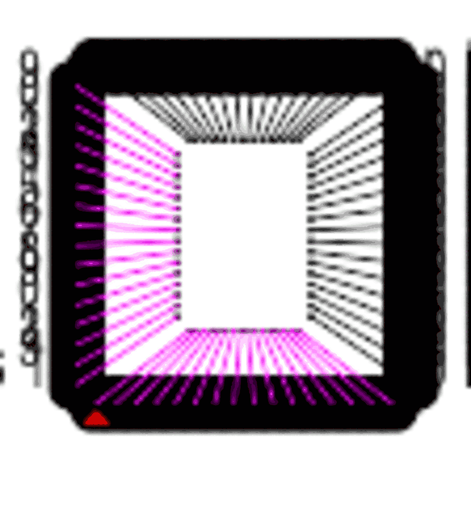

# IHP130 QFN64 封装图记录

状态：**仅记录来源与几何，未做 bondplan、未做 RLC、未冻结 pinout。**

## 来源

- 上游文件：`IHP-GmbH/TO_Sep2025`，提交 `113f1ab0426024b343a74071b34aee6d12de2b3e`
- 路径：`drc/QFN64.svg`
- 原始链接：
  `https://raw.githubusercontent.com/IHP-GmbH/TO_Sep2025/113f1ab0426024b343a74071b34aee6d12de2b3e/drc/QFN64.svg`
- 上游 README 的上下文：IHP TO Sep2025 默认发 10 颗裸片；需要封装时可提供 **QFN 或 open QFN，pin 数 24–64**。`drc/QFN64.svg` 是 **64-pin QFN 的示例 bonding plan**，不是封装厂 datasheet。
- 上游仓库 license：Apache-2.0。

本地副本：

- `docs/packages/ihp130_qfn64.svg` — 上游 SVG 原样副本
- `docs/images/ihp130_qfn64.png` — 预览图，仅用于文档阅读

## 从图里能确认的几何

- **64 lead**，四边各 16 lead。
- lead pitch 从 SVG 路径坐标看是 **0.5 mm**（相邻 lead 的 y 坐标差 0.5）。
- 图幅 **12 mm × 13 mm**（SVG `width=12mm height=13mm viewBox="0 0 12 13"`）。
- 本体轮廓按路径坐标约为 **9 mm × 9 mm**；具体塑封体/暴露 pad 尺寸仍以封装厂图纸为准。
- 图里有 pin 1 标记（红色三角）和 bond 手指，可作为我们 64-pad die 的 bonding plan 起点。

这些是从 SVG 几何读出的值，**不是从封装厂 datasheet 复制的签核尺寸**。QFN64 的 leadframe 厚度、金线直径、暴露 pad 尺寸、公差都还没有核对。

## 与当前 QFN40/QFN48 的关系

- 当前 `docs/PACKAGE_PADFRAME_PLAN.md` 的 QFN40/QFN48 coupon 和 `spice/package/qfn40_pkg.spice`、`qfn48_pkg.spice` **没有** QFN64 版本。
- QFN64 的 64 lead 对全 x8 DDR1 足够：32 signal + 32 power/ground/reference，比 QFN48 多 16 个 lead；代价是封装体从 7×7 增到 9×9 量级，bondwire 更长，最坏 L 可能高于 QFN48 的 3.04 nH。
- 在没有 QFN64 bondplan 和 RLC 之前，不能把 QFN64 的封装寄生写进 SDC 或 eye。

## 下一步（如果选 QFN64）

1. 用 IHP AMS template 的 `run_bondplan.py` + Europractice package library 生成 64-pad die 的 bondplan，检查 min gap、crossing、lead skew。
2. 按 25 µm 金线、200 µm leadframe、0.1 pF 集中电容提取每 pin RLC，补 `qfn64_pkg_rlc.json` 和 `spice/package/qfn64_pkg.spice`。
3. 冻结 pinout 后再决定是否替换 `ddr1_top` SDC 里的 QFN48 最差 pin 数值。
